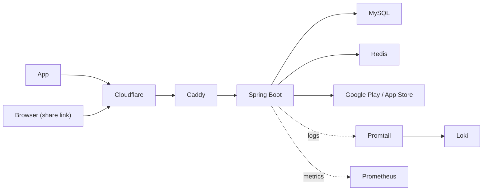

# Renzzle Backend

Renzzle 앱의 API 서버와 공유 링크 웹 페이지.

Java 17 · Spring Boot 3.3.2 · MySQL 8.0 · Redis 7.0 · Gradle 8.8

## Architecture



## Routes

- `/api/**`: 앱 API. `x-app-key` 헤더 필요 (`APP_KEY`가 비어 있으면 검사 안 함)
- `/admin/**`: 운영 API. 관리자 계정의 앱 토큰으로 호출
- `/puzzle/{token}`: 공유 링크 페이지. 로그인 불필요
- `/.well-known/**`: iOS Universal Links, Android App Links 파일
- `/webhooks/apple/notifications`: App Store 서버 알림
- `/docs`: API 문서 (Scalar). `DOCS_ENABLED`로 on/off
- `/actuator/prometheus`: 메트릭. `ACTUATOR_TOKEN` 없는 요청은 Caddy에서 차단

## Run Locally

`.env.example`을 `.env`로 복사해 값 입력 후 실행. 개발용 구성은 MySQL·Redis를 메모리에 두고 Caddy·Promtail은 제외.

```bash
cp .env.example .env
./gradlew bootJar
docker compose -f docker-compose.yml -f docker-compose.dev.yml up --build
```

서버 `http://localhost:9001`, API 문서 `http://localhost:9001/docs`

## Test

Testcontainers로 MySQL·Redis를 띄우므로 Docker 필요. `.env` 값을 환경 변수로 넣고 실행.

```bash
set -a && source .env && set +a
./gradlew test
```

## Deploy

- `main`, `develop` 대상 PR: CI에서 빌드·테스트
- PR 댓글 `/test deploy`: 테스트 서버 배포
- PR 댓글 `/renzzle deploy`: 운영 서버(EC2) 배포

## AI Engine (WASM)

공유 링크 페이지의 엔진은 [Renzzle_AI](https://github.com/Renzzle/Renzzle_AI)의 WebAssembly 빌드. 엔진 변경 시 `engine-wasm/build.sh`의 `AI_COMMIT`을 올려 실행하고, `src/main/resources/static/assets/engine`의 `renzzle-engine.mjs`, `renzzle-engine.wasm`을 커밋. git·Docker 필요.

```bash
./engine-wasm/build.sh
```
