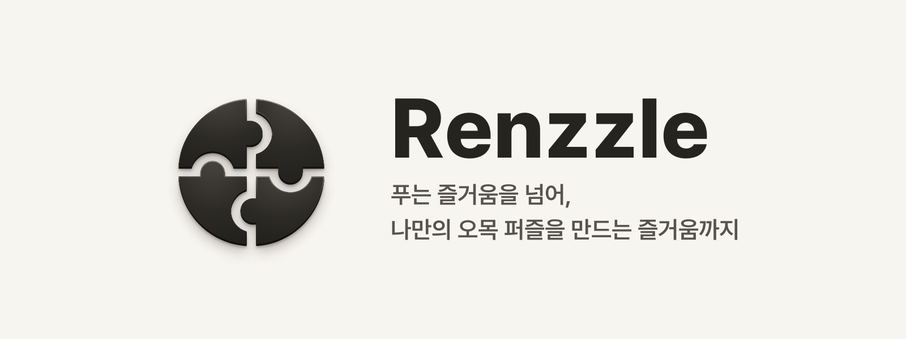
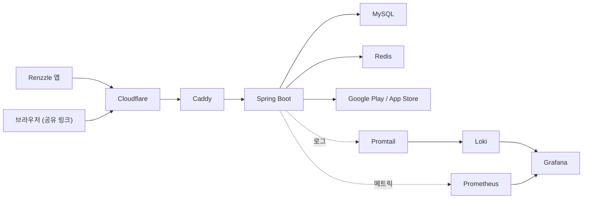

# Renzzle

## 🎯 Project Overview

Renzzle은 오목 초보자부터 전문가까지 누구나 즐기며 실력을 향상시킬 수 있는 AI 기반 오목 퍼즐 학습 플랫폼입니다.

- 트레이닝 퍼즐: 정교한 AI를 상대로 단계별 퍼즐을 풀며 체계적인 학습이 가능합니다.
- 커뮤니티 퍼즐: 사용자가 직접 퍼즐을 만들고 공유하며, 다른 유저의 퍼즐에 도전할 수 있습니다.
- AI 문제 검증: 유저가 만든 모든 퍼즐은 AI가 풀이 가능성을 검증하여 콘텐츠의 질을 보장합니다.
- 랭킹 시스템: 랭킹전을 통해 다른 사용자들과 실력을 겨루며 학습 동기를 부여합니다.

## 💻 Tech Stack

<h4>Backend</h4>

<h4>Database & Cache</h4>

<h4>DevOps & Infra</h4>

<h4>Monitoring</h4>

<h4>Testing</h4>

<strong>🛠️ Key Version Details</strong>

|    Category    |          Tech          |      Version      |
|:--------------:|:----------------------:|:-----------------:|
|  **Language**  |          Java          |       `17`        |
| **Framework**  |      Spring Boot       |      `3.3.2`      |
|  **Database**  |     MySQL / Redis      | `8.0` / `7.0.12`  |
|  **Testing**   | JUnit / Testcontainers | `5.10` / `1.21.4` |
| **Build Tool** |         Gradle         |       `8.8`       |

## 🗺️ Architecture

